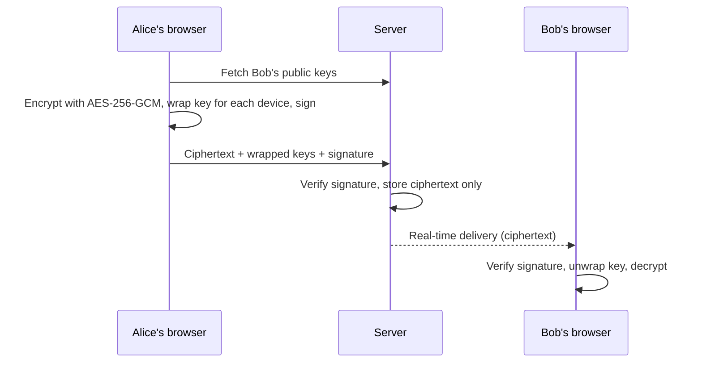
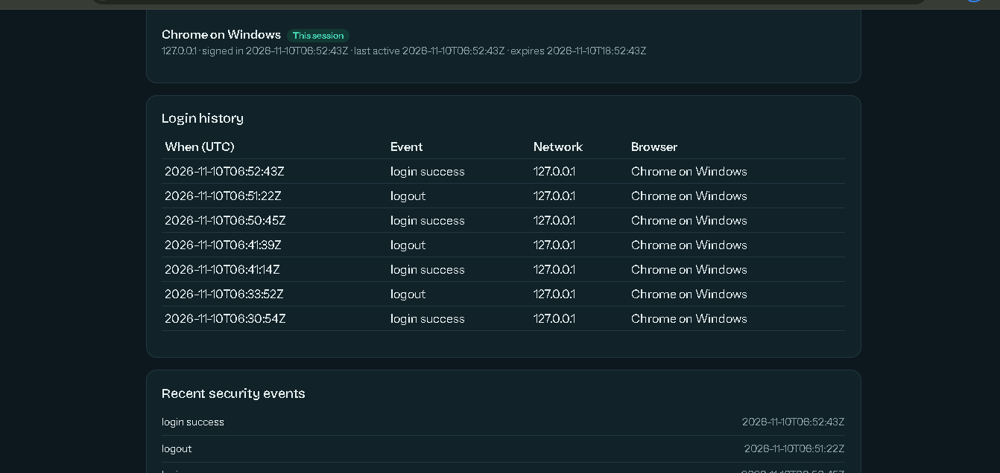

# Sealed: end-to-end encrypted messenger


A private messaging app where messages are encrypted in the browser and the server only stores ciphertext. Built with Flask, Flask-SocketIO, SQLAlchemy and WebCrypto.

> Educational project. The protocol composes standard primitives but has **not** been independently audited. See [docs/SECURITY_MODEL.md](docs/SECURITY_MODEL.md).


## Features
- Registration, login/logout, Argon2id hashing, lockout, rate limiting, session expiry, password reset, account settings
- Client-side E2EE: X25519 + HKDF + AES-256-GCM, Ed25519 signatures, unique nonces, key rotation
- One-to-one and group chats (admins, add/remove members), real-time delivery, read receipts, typing, presence, unread counters, delete for everyone
- Security dashboard: encryption status, devices and fingerprints, active sessions, login history, suspicious-login alerts
- Dark/light themes, responsive layout (mobile and desktop)

## What makes it interesting
- **The server only sees ciphertext.** Encryption and signing happen in the browser with WebCrypto. Private keys are created non-extractable and never leave the device.
- **Two implementations that must agree.** The Python reference (`cryptography` library) and the JavaScript client are tested against each other in both directions, so a message encrypted by one decrypts in the other.
- **Tamper-proof messages.** Every message is signed with Ed25519 and verified before decryption. Changing the ciphertext, sender, conversation id or a recipient envelope makes it fail.
- **Replay protection.** Unique message ids, a signed timestamp window and context binding stop captured messages being re-sent.
- **Safety numbers.** Users can compare key fingerprints to detect a man-in-the-middle, and the app warns when a contact's key changes.
- **Real session security.** Revocable server-side sessions, WebSockets that close when a session is revoked, suspicious-login alerts, lockout and CSRF protection.

## Tech stack
| Layer | Technology |
|---|---|
| Backend | Python 3.12, Flask, Flask-SocketIO, SQLAlchemy |
| Database | SQLite (dev), PostgreSQL (production) |
| Frontend | HTML5, CSS3, JavaScript (ES modules), Bootstrap 5 |
| Cryptography | X25519, HKDF-SHA256, AES-256-GCM, Ed25519, Argon2id |
| Testing | pytest, Node test runner |
| Deployment | Docker, Docker Compose, Render |

## How a message travels

More detail: [docs/ARCHITECTURE.md](docs/ARCHITECTURE.md) and [docs/API.md](docs/API.md).

## Screenshots
| Chat | Security dashboard |
|---|---|
|  |  |

## Quick start (Windows PowerShell)
Requires Python 3.12+ and a recent Chrome, Edge, Firefox or Safari. Use `localhost` or `127.0.0.1`, because WebCrypto needs a secure context.

```powershell
git clone https://github.com/YOUR-USERNAME/secure-messenger.git
cd secure-messenger
py -3.12 -m venv .venv
.\.venv\Scripts\Activate.ps1
pip install -r requirements-dev.txt
flask --app run seed-demo
python run.py
```

Open http://127.0.0.1:5000 and sign in with a demo account:

| User | Username | Password |
|---|---|---|
| Alice | `alice_demo` | `Sealed-Demo-2026!` |
| Bob | `bob_demo` | `Sealed-Demo-2026!` |

The demo accounts are for local use only. `seed-demo` refuses to run in production.

### Try a chat
1. Sign in as `alice_demo` in one browser and as `bob_demo` in a private window, using the same address in both.
2. Let each page load, so each browser creates its device keys.
3. In Alice's window click **+**, search `bob`, and send a message. It appears in Bob's window in real time.
4. Open the **Security dashboard** from the menu (⋮) to see devices, fingerprints, sessions and login history.

### Run the tests
```powershell
pytest
node --test tests/js/*.test.mjs
```

## Run on Linux
```bash
python3 -m venv .venv && source .venv/bin/activate
pip install -r requirements.txt
export APP_ENV=production SECRET_KEY=$(python -c "import secrets;print(secrets.token_hex(32))") COOKIE_SECURE=false
gunicorn --worker-class gthread --workers 1 --threads 100 --bind 0.0.0.0:8000 run:app
```
Put it behind an HTTPS reverse proxy (set `COOKIE_SECURE=true` and `TRUSTED_PROXY_COUNT=1`, and forward WebSocket upgrades).

## Run with Docker
Create a `.env` file containing `SECRET_KEY` and `POSTGRES_PASSWORD`, then:
```powershell
docker compose up --build
```
Open http://localhost:8000. Since this runs over plain http, add `COOKIE_SECURE=false` to `.env`.

## Deploy
See [DEPLOY.md](DEPLOY.md) for Render (free tier) instructions.

## Configuration
See `.env.example`. Never commit `.env`, databases or keys (`.gitignore` covers them).

## Roadmap
- [ ] Double Ratchet for forward secrecy
- [ ] Encrypted file and image attachments
- [ ] Multi-device key backup
- [ ] Redis message queue for horizontal scaling
- [ ] Disappearing messages
- [ ] Independent security audit

## What I learned
- How key agreement, key derivation and authenticated encryption fit together
- Why authenticating the sender matters as much as hiding the content
- Web security basics: CSRF, CSP, session management and rate limiting
- Why two implementations in different languages need interoperability tests

## Known limitations
This is a learning project. It has no per-message forward secrecy, trusts keys on first use, and has not been independently audited. See [docs/SECURITY_MODEL.md](docs/SECURITY_MODEL.md) for the full list. Do not use it for high-risk communication.

## Contributing
See [CONTRIBUTING.md](CONTRIBUTING.md). License: [MIT](LICENSE).
