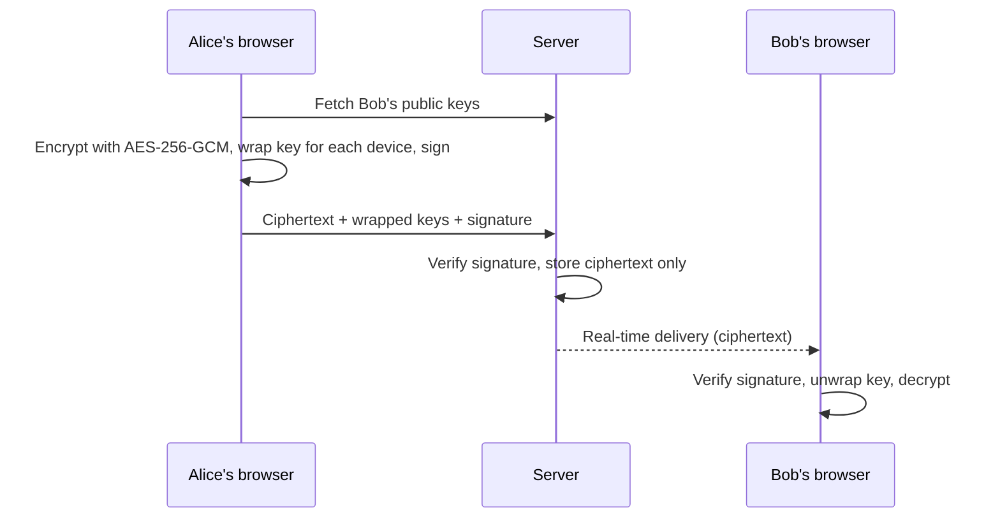

## Why I built this
Most chat apps ask you to trust the server. I wanted to build one where the server **cannot** read your messages, and to learn how real end-to-end encryption works by implementing it with standard, vetted cryptography instead of inventing my own.

## What makes it interesting
- **The server only sees ciphertext.** Encryption and signing happen in the browser with WebCrypto. Private keys are created non-extractable and never leave the device.
- **Two implementations that must agree.** The Python reference (`cryptography` library) and the JavaScript client are tested against each other in both directions, so a message encrypted by one decrypts in the other.
- **Tamper-proof messages.** Every message is signed with Ed25519 and verified before decryption. Changing one byte of the ciphertext, the sender, the conversation id or a recipient envelope makes it fail.
- **Replay protection.** Unique message ids, a signed timestamp window, and context binding stop captured messages being re-sent.
- **Safety numbers.** Users can compare key fingerprints to detect a man-in-the-middle, and the app warns when a contact's key changes.
- **Real session security.** Revocable server-side sessions, live WebSockets that close when a session is revoked, suspicious-login alerts, lockout and CSRF protection.

## Tech stack
| Layer | Technology |
|---|---|
| Backend | Python 3.12, Flask, Flask-SocketIO, SQLAlchemy |
| Database | SQLite (dev), PostgreSQL (production) |
| Frontend | HTML5, CSS3, JavaScript (ES modules), Bootstrap 5 |
| Cryptography | X25519, HKDF-SHA256, AES-256-GCM, Ed25519, Argon2id |
| Testing | pytest, Node test runner |
| Deployment | Docker, Docker Compose, Render |

## How a message travels

## Try it in 2 minutes
1. Start the app and create two accounts, each in a different browser or a private window.
2. Open the chat page in **both** browsers once, so each creates its device keys.
3. Start a chat from the **+** button, send a message, and watch it arrive in real time with typing indicators and read ticks.
4. Open the **Security dashboard** from the menu to see devices, fingerprints, sessions and login history.
5. Open `instance/messenger.db` and look at the message rows. You'll see only unreadable ciphertext.

## Roadmap
- [ ] Double Ratchet for forward secrecy
- [ ] Encrypted file and image attachments
- [ ] Multi-device key backup
- [ ] Redis message queue for horizontal scaling
- [ ] Disappearing messages
- [ ] Independent security audit

## What I learned
- How key agreement, key derivation and authenticated encryption fit together
- Why authenticating the sender matters as much as hiding the content
- Web security basics: CSRF, CSP, session management and rate limiting
- Why untested assumptions between two languages (Python and JavaScript) need interoperability tests

## Known limitations
This is a learning project. It has no forward secrecy per message, trusts keys on first use, and has not been independently audited. See [docs/SECURITY_MODEL.md](docs/SECURITY_MODEL.md) for the full list. Do not use it for high-risk communication.
