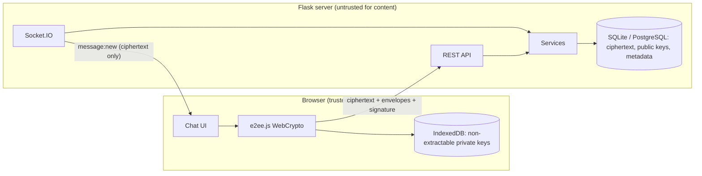

# Architecture

Layers: `routes/` (HTTP), `services/` (business rules), `models/` (SQLAlchemy), `security/` (CSRF, headers, auth middleware, passwords, E2EE protocol), `sockets/` (realtime). The Python `e2ee_protocol.py` is used by the server only to validate keys and verify signatures; encrypt/decrypt exist for tests and as a reference that is proven interoperable with `static/js/e2ee.js`.
